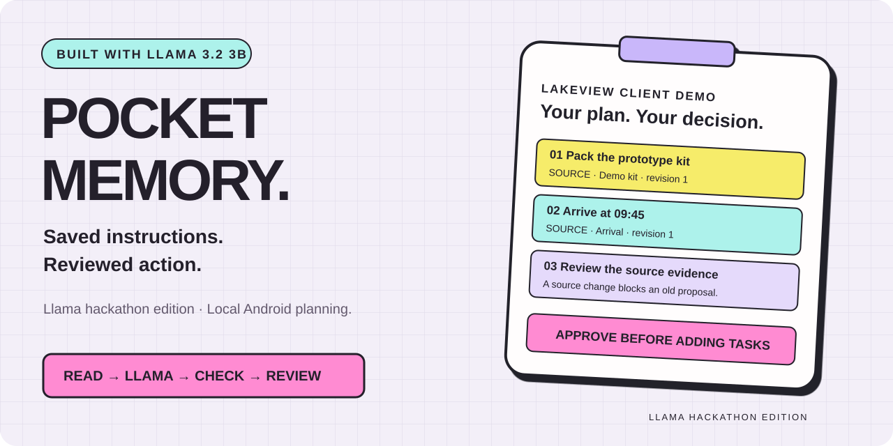
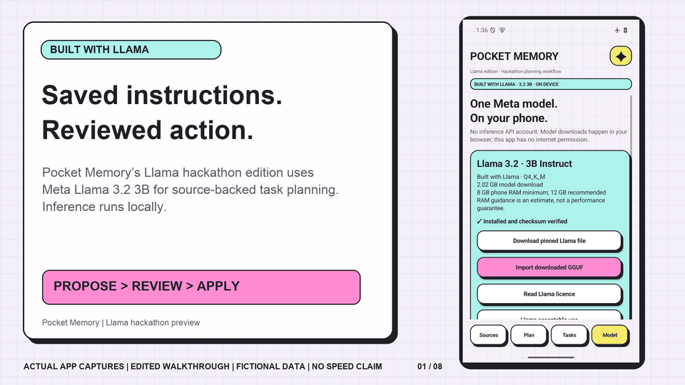
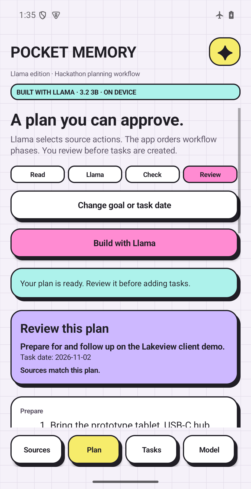
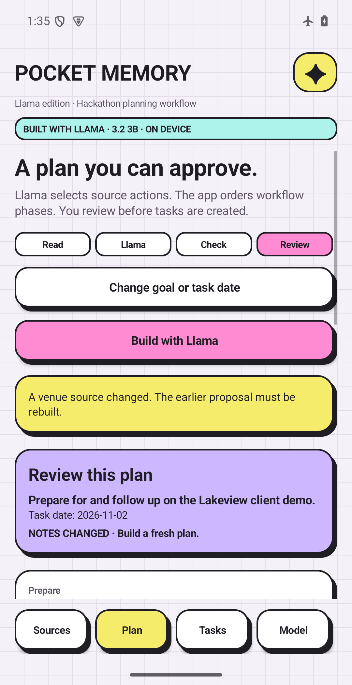
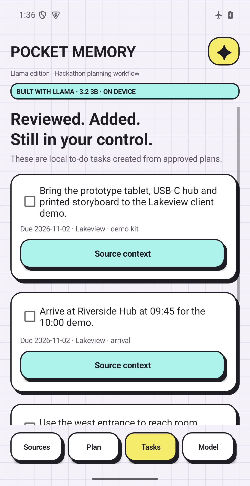
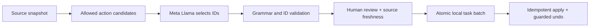

<p align="center"></p>

# Pocket Memory · Llama edition

**Turn scattered instructions into a plan you can inspect, approve and undo.**

Pocket Memory’s native Android Llama hackathon edition turns saved instructions into reviewed tasks. Meta **Llama 3.2 3B Instruct** selects relevant actions from your notes; application rules order the workflow phases, entirely on the device. The app checks every selected ID, preserves source evidence and waits for your review before creating a local task batch.

[](https://github.com/MANTHAN137/pocket-memory-llama/actions/workflows/android.yml)


[Download APK & narrated demo](https://github.com/MANTHAN137/pocket-memory-llama/releases/tag/v0.6.0-plans) · [Project brief](docs/PocketMemory-Plans-Project-Brief.pdf) · [Run the example](docs/DEMO.md) · [Architecture](docs/ARCHITECTURE.md) · [Verification](docs/VERIFICATION.md)



*Actual Android captures with fictional data, edited into a walkthrough. Transitions do not simulate taps or represent inference speed. The narrated video is under three minutes.*

## The new workflow

The fictional Lakeview client demo has five separate notes: arrival, equipment, venue, follow-up and an unrelated party. Llama keeps the client actions and leaves out the party. The app groups preparation before arrival, access and explicit follow-up. Each proposed task contains exact source text; the model cannot invent a new executable instruction.

1. **Read** — take an immutable snapshot of relevant saved instructions.
2. **Llama** — select relevant candidate IDs with grammar-constrained local inference.
3. **Check** — validate IDs, duplicates, limits and source versions; order explicit workflow phases.
4. **Review** — inspect evidence, select actions and explicitly add a batch.
5. **Recover** — repeated apply does not duplicate tasks; guarded undo preserves completed or changed work.

When the venue changes from Cedar to Orchid, the old proposal becomes stale. Applying it creates **zero tasks**. Rebuild with Llama, review the current source and apply again.

<table><tr><td width="33%"></td><td width="33%"></td><td width="33%"></td></tr><tr><td>Review the proposed actions</td><td>A source change blocks apply</td><td>Approve a real local task batch</td></tr></table>

## Practical use cases

| Situation | Saved instructions | Reviewed result |
|---|---|---|
| Client demo | Arrival, kit, room and follow-up | Prepare → attend → follow up, with unrelated events excluded |
| Community workshop | Bring supplies, arrive early, return borrowed kit | An ordered checklist tied to the organizer's notes |
| Household project | Collect parts, check measurements, return equipment | A local task batch whose evidence stays inspectable |
| Student presentation | Bring materials, review slides, submit handout | Action selection from explicit instructions, with human approval |

The client-demo case is verified with actual Llama inference. Other rows are intended uses, not independently measured quality results. This prototype handles explicit English action sentences and one user-selected task date; it does not infer deadlines or send messages.

## Why Meta matters here

Llama performs semantic action selection. Application rules enforce the phase order, preserving Llama's order within a phase. Keyword matching only supplies candidates, including an irrelevant event that shares the same name. The actual recorded output selects the relevant action IDs. A restricted decoder, strict Java validator and SQLite transactions constrain how model output can affect application state.

**Only Meta Llama 3.2 3B is offered in this edition.** No hosted Meta API, Muse model, model-credit redemption or hosted fallback is used. The model is imported separately; the APK has no `INTERNET` permission. External download links open your browser.

| Model property | Pinned value |
|---|---|
| Upstream | [meta-llama/Llama-3.2-3B-Instruct](https://huggingface.co/meta-llama/Llama-3.2-3B-Instruct) |
| GGUF | [bartowski/Llama-3.2-3B-Instruct-GGUF](https://huggingface.co/bartowski/Llama-3.2-3B-Instruct-GGUF) |
| Quantization | Q4_K_M |
| Revision | `5ab33fa94d1d04e903623ae72c95d1696f09f9e8` |
| Bytes | `2019377696` |
| SHA-256 | `6c1a2b41161032677be168d354123594c0e6e67d2b9227c84f296ad037c728ff` |

Review the bundled [Llama license](app/src/main/assets/licenses/llama-3.2.txt) and [Acceptable Use Policy](app/src/main/assets/licenses/llama-3.2-use-policy.txt). Model weights are excluded from this repository and APK. See [third-party notices](THIRD_PARTY.md).

## Try the standalone preview

1. Download `PocketMemory-Plans-0.6.0.apk` and its checksum from the release. It is a **debug-signed hackathon evaluation APK**.
2. Install on ARM64 Android 13+. Allow roughly 2.1 GB for the model plus app/runtime space. 8 GB RAM minimum and 12 GB recommended are estimates; physical-phone performance remains unverified.
3. In **Model**, review Llama terms. Download the pinned GGUF through your browser, then **Import GGUF**. Import checks exact size and SHA-256 before enabling inference.
4. In **Sources**, tap **Load fictional example**. Open **Plan**, review the goal/date, then **Build with Llama**.
5. Inspect evidence and review the selected actions before adding tasks. See [the detailed example](docs/DEMO.md).

The test evidence uses an isolated ARM64 Android 15 emulator in airplane mode. Model import and local inference are real. All recorded example data is fictional.

## Build and reproduce

Requirements: JDK 17, Python 3, Android SDK platform 36, Build Tools 35.0.0, NDK 30.0.16248370, CMake 3.31.6. Gradle 8.13 and Android Gradle Plugin 8.13.2 are pinned. No API keys are required.

```sh
export JAVA_HOME=/path/to/jdk-17
export ANDROID_HOME=/path/to/android-sdk
sh scripts/cloud_setup.sh
sh scripts/build.sh
# After reviewing the model license and use policy:
python3 scripts/download_model.py
python3 scripts/run_meta_demo.py --serial emulator-5554
```

The last command intentionally resets only the standalone planner's fictional test database and changes only the test emulator to airplane mode. It refuses physical-device serials. Start an ARM64 Android 15 emulator first with sufficient free storage and RAM. Real inference is tested locally; CI builds, lints and checks APK alignment without downloading weights.



## Work built during the hackathon

This edition adds the focused Llama planning workflow: Android planning screens, immutable source snapshots, the constrained JNI adapter, review and execution controls, transactional tasks, verification and demo materials. Pocket Memory’s existing concept/design palette and the public llama.cpp runtime are acknowledged foundations. The demo highlights the newly built planning functionality. [Contribution details](docs/HACKATHON.md).

## Limits and next steps

Llama may select an irrelevant candidate or omit a useful action. Phase rules group Bring/Pack/Collect/Buy/Prepare before Arrive/act, then Use/access, then notes beginning After/Following. These rules are intentionally narrow and can misclassify instructions. Structural validation prevents arbitrary IDs and invented task text, but does not prove relevance or correct phase grouping. Users must inspect the proposal. Candidate extraction is intentionally bounded (50 notes, 8 relevant notes, 16 candidate actions, 6 selected steps, 4,096-token context). Long notes or unsupported sentence patterns can be omitted or refused. Plans use one chosen date; they do not schedule alarms or external actions.

Next work: physical-device profiling, broader relevance evaluation, improved action extraction and accessible large-text testing. No accuracy percentage, battery measurement or production-readiness claim is made.

New project code is MIT licensed; model and vendored components retain their own terms. Pocket Memory branding remains with its owner.
