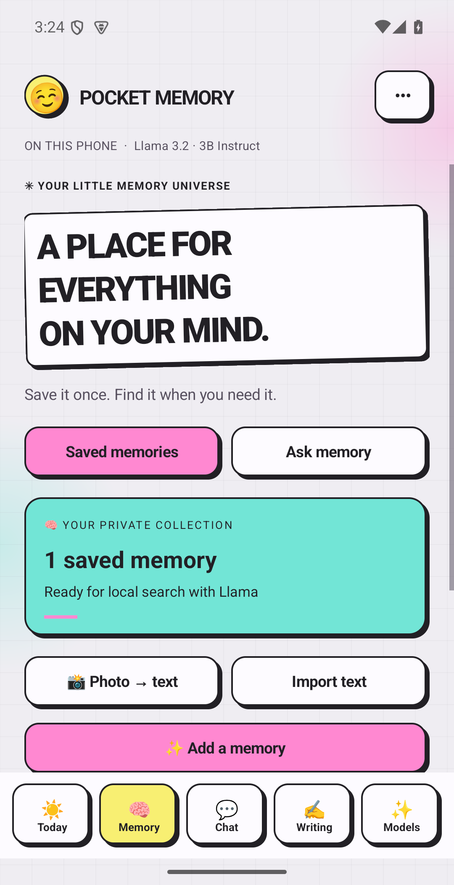
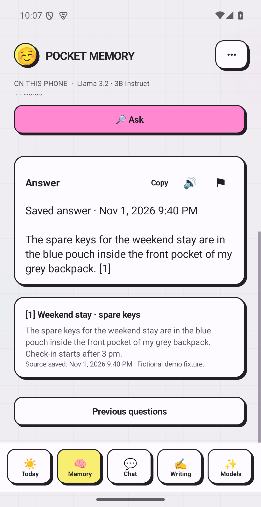
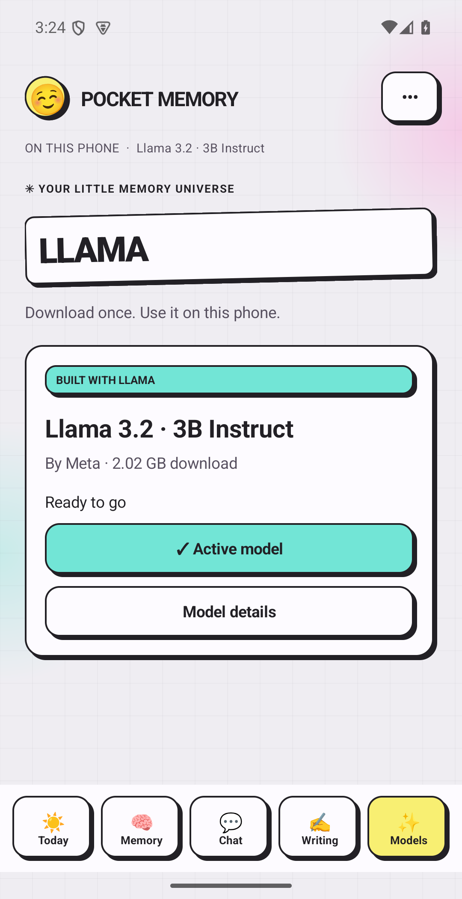

# Pocket Memory · Built with Llama

**Save what matters. Ask Llama when you need it.**

Pocket Memory is a native Android personal memory app. Save notes, ask questions about them, chat with Meta Llama, improve a draft, and manage daily tasks in the familiar Pocket Memory interface. Llama inference runs on the phone.

This edition offers **Meta Llama 3.2 3B Instruct** as its only language model. Download it inside **Models**, wait for verification, then tap **Use this model**. No file picker or import step is required.

[Download Android APK](https://github.com/MANTHAN137/pocket-memory-llama/releases/download/v0.8.0-llama/PocketMemory-Llama-0.8.0.apk) · [Watch the 2:05 narrated walkthrough](https://github.com/MANTHAN137/pocket-memory-llama/releases/download/v0.8.0-llama/PocketMemory-Llama-Demo.mp4) · [Preview](https://manthan137.github.io/pocket-memory-llama/)

<table><tr><td width="33%"></td><td width="33%"></td><td width="33%"></td></tr></table>

The narrated walkthrough is edited from actual Android/browser captures with fictional data. No simulated taps or inference-speed claim. [Media provenance](docs/evidence/media-provenance.json).

## What you can do

| Need | Where to go | Example |
|---|---|---|
| Remember a detail | Memory → Add | Save where the spare keys are kept for a weekend stay. |
| Find it later | Ask your memory | “Where did I keep the spare keys?” Llama answers with a saved-memory reference. |
| Talk to Llama | Chat | Ask a question or develop an idea using the local model. |
| Improve a draft | Writing | Fix grammar or summarize text; review before replacing your draft. |
| Keep track of the day | Today | Use Pocket Memory's existing tasks and reminders. |
| Check public information | Chat → Search the web | One MCP search, followed by a local Llama answer and source URLs. |
| Let a browser agent help | Settings → Browser companion | Search saved memories or ask the phone's Llama through WebMCP. |

The revised demo shows travel recall, a corrected client brief with an explicitly labeled source-only fallback, Google Maps web research, and a real WebMCP client lookup. All use fictional data and actual app output. [Replay the cases](docs/DEMO.md). Model quality varies; sources still need review.

## Android setup

The evaluation APK is **PocketMemory-Llama-0.8.0.apk**, ARM64 Android 13+. The approximately 2 GB model downloads separately. Plan for at least 2.2 GB free storage. 8 GB RAM is a planning guide; smaller devices receive a warning and may fail to load the model. Physical-phone performance remains unverified.

1. Install the evaluation APK and open Pocket Memory.
2. Review setup and the Llama license. Open **Models → Download Llama**.
3. Stay in the app or use its download notification. Pause/resume is supported.
4. Once the file passes its size and SHA-256 checks, tap **Use this model**.
5. Add a memory, then ask a question about it. Memory answers, Chat and Writing work without a network after setup.

Downloaded weights remain in private app storage across restarts. Clearing app storage or uninstalling removes them. This build has its own app identity, `com.pocketmemory.llama`.

## Two web connections, each with a clear purpose

**Android MCP search:** enable **Search the web** in Chat. Only the message you send goes to Exa's MCP endpoint. Saved memories and earlier messages are not attached. The application permits one allowlisted search and one local answer, then stops. Requests, traffic, context, tokens and elapsed time are bounded; Stop cancels work. There are no automatic research retries.

**WebMCP browser companion:** open it from Settings on the same phone. An expiring local connection exposes five tools: model status, memory search, memory Q&A, Llama chat and web search. The browser needs WebMCP support for agent tools; its ordinary buttons also work. The companion cannot edit/delete memories, download models or perform payments. A browser agent may process returned content under its provider's policy, so use only information you intend to share with that agent.

The companion binds only to phone loopback, uses a one-use connection code and a 15-minute session, refuses cross-origin requests, and caps operations and model generations. [Protocol, privacy and stop conditions](docs/MCP.md).

## Model and build

| Property | Value |
|---|---|
| Upstream | [Meta Llama 3.2 3B Instruct](https://huggingface.co/meta-llama/Llama-3.2-3B-Instruct) |
| Quantization | [bartowski GGUF](https://huggingface.co/bartowski/Llama-3.2-3B-Instruct-GGUF), Q4_K_M |
| Pinned revision | `5ab33fa94d1d04e903623ae72c95d1696f09f9e8` |
| Bytes | `2019377696` |
| SHA-256 | `6c1a2b41161032677be168d354123594c0e6e67d2b9227c84f296ad037c728ff` |

Weights are excluded from the APK and repository. Review the bundled [Llama license](app/src/main/assets/licenses/llama-3.2.txt), [use policy](app/src/main/assets/licenses/llama-3.2-use-policy.txt) and [third-party notices](THIRD_PARTY.md). This app uses Llama locally; no hosted language-model fallback is configured.

Run fictional-data checks only on an isolated emulator after setting up the model: `python3 scripts/run_edition_checks.py --serial emulator-5554 --stage guards`. See verification for the inference, download and restart stages.

Build with JDK 17, Android SDK 36, Build Tools 35.0.0, NDK 30.0.16248370 and CMake 3.31.6. Gradle 8.13 and AGP 8.13.2 are pinned.

```sh
export JAVA_HOME=/path/to/jdk-17
export ANDROID_HOME=/path/to/android-sdk
sh scripts/build.sh
```

[Architecture](docs/ARCHITECTURE.md) · [Example](docs/DEMO.md) · [Verification](docs/VERIFICATION.md) · [Hackathon contribution disclosure](docs/HACKATHON.md)

Pocket Memory's existing Android app is the foundation. This edition's changes are the Llama-only setup, simpler model download/use flow, bounded MCP web answers and optional WebMCP companion. Existing Memory, Chat, Writing and Today are acknowledged rather than represented as newly invented hackathon features. The owner authorized publication of this edition. Pre-existing Pocket Memory product code retains its copyright; standalone MCP/WebMCP files are MIT licensed. See LICENSE for the exact scope.
